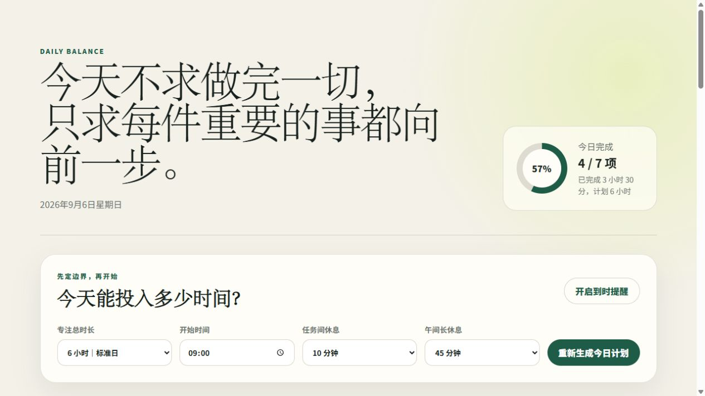
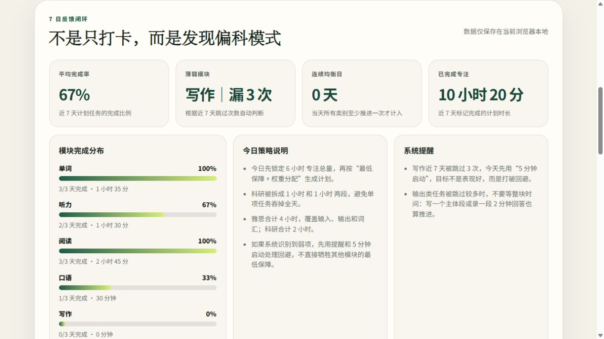
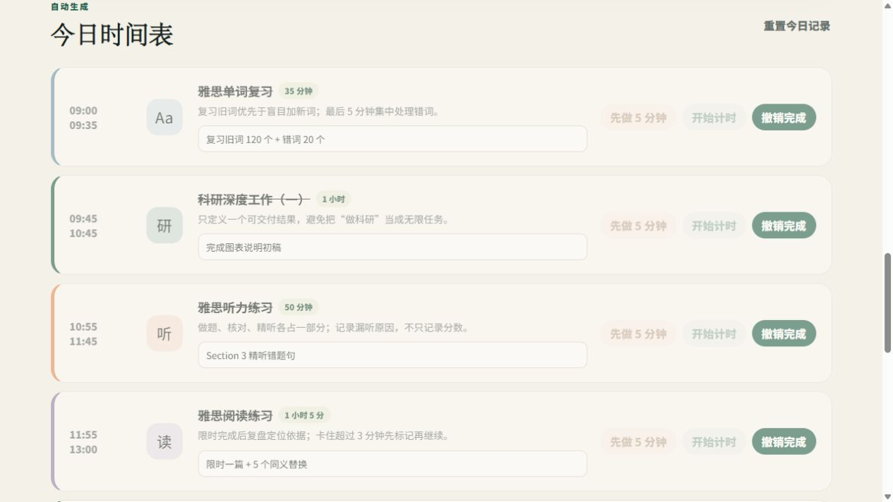

# Self Work Station｜Daily Balance Planner

一个面向“雅思备考 + 科研工作并行”场景的本地优先任务均衡系统。项目目标不是简单打卡，而是帮助用户避免一整天只做单项任务，并通过近 7 天记录识别偏科和回避模式。

## 使用示例

### 1. 每日计划总览

用户先设置当天可投入的专注总时长、开始时间、任务间休息和午间长休息，系统自动生成当天任务边界。



### 2. 7 日反馈闭环

系统根据本地记录计算近 7 天完成率、薄弱模块、连续均衡日和各模块完成分布，把“有没有打卡”进一步变成“哪里长期失衡”。



### 3. 任务时间表与小目标

每个任务都有时间边界、今日小目标、完整计时和“先做 5 分钟”启动按钮，用来降低弱项任务的心理阻力。



## 项目背景

在多目标学习场景中，用户常见问题不是“不知道要做什么”，而是：

- 容易被一个任务占满全天，例如一直写科研或一直练阅读。
- 对弱项任务产生回避，例如口语、写作、听力复盘迟迟不开始。
- 手动任务表缺少反馈，无法看出自己长期跳过了哪些模块。

Daily Balance Planner 用“最低保障 + 权重分配 + 任务穿插 + 5 分钟启动 + 7 日反馈闭环”解决这个问题。

## 当前版本：V2 数据闭环版

### 核心功能

- 自动生成每日计划：覆盖雅思单词、听力、阅读、口语、写作和科研深度工作。
- 时间分配算法：每项任务有最低保障时间，剩余时间按权重分配。
- 科研拆分：科研被拆成两个区块，避免单项任务吞掉全天。
- 5 分钟启动：对畏惧任务先启动，不要求马上进入完美状态。
- 倒计时提醒：任务结束后提醒切换，支持浏览器通知、页面提示和提示音。
- 本地保存：完成状态、小目标、复盘内容保存在浏览器 localStorage。
- 7 日统计：
  - 平均完成率
  - 薄弱模块识别
  - 连续均衡日
  - 近 7 天完成专注时长
  - 各模块完成分布
- 策略说明：页面解释今日计划为什么这样分配。

## 使用方式

直接双击 `index.html` 即可打开。推荐使用 Chrome 或 Edge。

也可以在本目录运行本地服务：

```powershell
npm start
```

然后访问：

```text
http://localhost:8000
```

如需查看带样例数据的演示页面，可访问：

```text
http://localhost:8000/?demo=1
```

## 测试

本项目无需安装依赖。需要 Node.js。

```powershell
node --check app.js
node smoke-test.mjs
```

测试覆盖：

- 页面引用的元素是否存在
- 静态资源是否齐全
- 时间分配总和是否等于用户设置的总专注时长
- 跨午夜时间格式化
- 近 7 天统计
- 薄弱模块识别
- 连续均衡日统计

## 技术栈

- HTML
- CSS
- 原生 JavaScript
- localStorage
- Notification API
- Node.js smoke test

## 作品集价值

这个项目可以展示：

- 产品问题拆解：从真实学习痛点出发，不是单纯做 UI。
- 规则建模：把“均衡学习”转化为可验证的时间分配算法。
- 数据意识：通过近 7 天记录识别偏科和回避模式。
- 用户体验设计：用 5 分钟启动机制降低弱项任务的心理阻力。
- 工程完整度：具备 README、测试、文档和版本路线。

## 秋招网申项目经历概述

**项目名称：** Self Work Station｜Daily Balance Planner  
**项目角色：** 独立开发者 / 产品设计与前端实现  
**项目类型：** AI 辅助开发个人效率工具  
**项目关键词：** local-first、任务规划、数据闭环、原生 JavaScript、Vibe Coding

**项目简介：**

面向雅思备考与科研并行场景，设计并实现一个本地优先的每日均衡计划系统。系统通过“最低保障时间 + 权重分配”算法自动生成每日计划，将雅思单词、听力、阅读、口语、写作和科研任务穿插安排，并通过 5 分钟启动机制降低弱项任务回避。V2 版本加入近 7 天本地数据统计，计算平均完成率、连续均衡日和薄弱模块，形成从计划、执行到复盘的闭环。

**个人贡献：**

- 从个人备考与科研并行痛点出发，完成需求拆解、产品规则设计、交互设计和页面实现。
- 设计时间分配规则，将“每天均衡推进”转化为最低保障时间、权重分配、任务穿插和科研拆分策略。
- 使用原生 HTML/CSS/JavaScript 实现响应式页面、计时器、浏览器提醒、本地存储和 7 日统计看板。
- 编写 smoke test 验证核心算法、DOM 引用、跨午夜时间格式化和历史统计逻辑。
- 补齐 README、产品设计、架构说明、路线图和项目经历文档，使项目可演示、可复盘、可放入作品集。

**项目亮点：**

- 不只是 To-do List，而是针对“偏科”和“弱项回避”设计的执行系统。
- 数据保存在浏览器本地，无需账号和后端，降低隐私风险和使用门槛。
- 从 V1 每日计划升级到 V2 数据闭环，体现持续迭代和产品化思路。

更多说明见：

- [产品设计说明](docs/product-design.md)
- [工程架构说明](docs/architecture.md)
- [秋招作品集讲法](docs/portfolio-case.md)
- [网申项目经历填写模板](docs/application-project-experience.md)
- [路线图](docs/roadmap.md)
