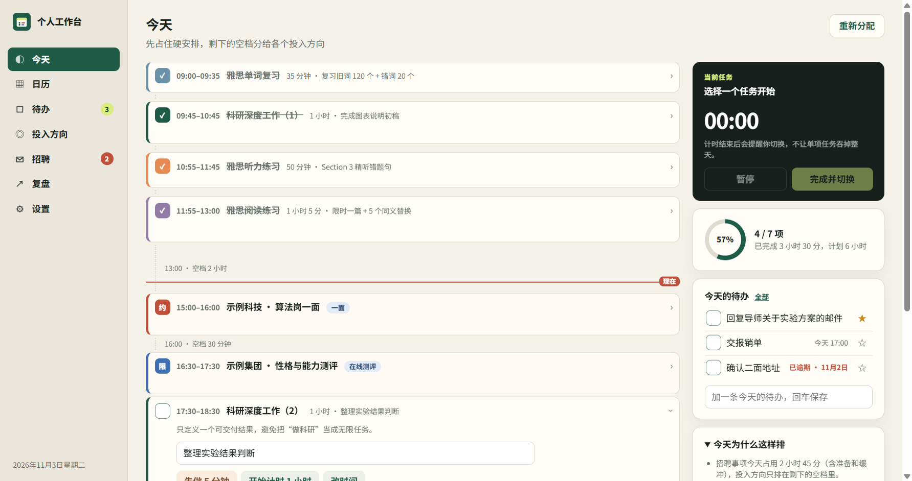
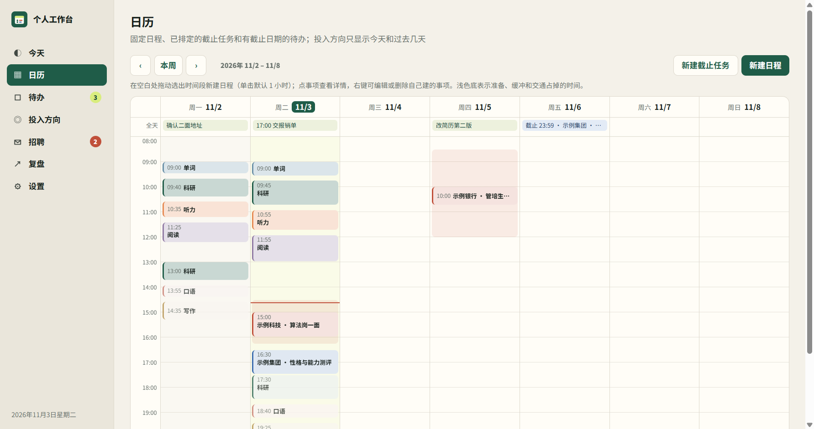
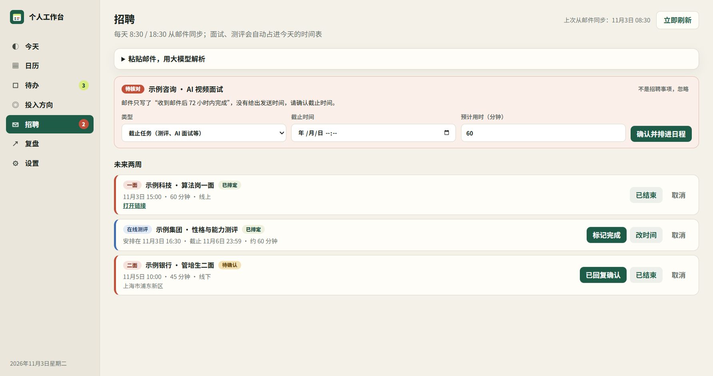
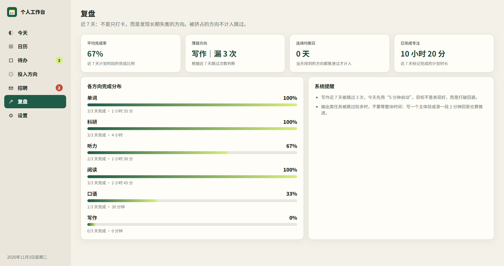

# Self Work Station｜个人工作台

一个本地优先的个人工作台，解决两件事：

1. **招聘事项不再漏**：面试邀约、在线测评、AI 面试这些招聘邮件，由 Claude 每天自动读取两次，提取成日程。到点后，电脑会弹出 Windows 通知提醒你。
2. **每天的时间有人帮你分**：先给招聘事项占住时间（含准备和缓冲），剩下的空档再按“最低保障 + 权重”分给雅思和科研。被挤掉的模块不算你回避。

> V3 在 V2「Daily Balance Planner」的基础上扩展而来，原有的均衡计划、5 分钟启动和 7 日反馈都保留了。

## 它是怎么工作的

```text
163 邮箱 ──(收信规则自动转发)──▶ Gmail
                                  │  Claude 定时任务（每天 8:30 / 18:30）
                                  ▼
                    本机 data/items.json（只在你电脑上）
                                  │
                                  ▼
     桌面程序「个人工作台」：排时间 · 今天时间轴 · Windows 到点提醒 · 标记完成写回
```

- **固定日程**（面试等，时间由对方定）：占用“前 30 分钟准备 + 事项本身 + 后 15 分钟缓冲”，线下的再加往返交通（默认 1 小时）。
- **截止任务**（测评、AI 面试等，在窗口内自己选时间）：自动排进窗口内最早的整块空档，避开饭点和面试，并且尽量不拖到截止当天。可以手动改时间。
- **提醒**：
  - 固定日程：前一天 20:00 提醒一次，开始前 1 小时再提醒一次。
  - 截止任务：排定的时段开始时提醒；截止前 24 小时还没完成，再追加一次。
  - 待确认邀约、有变更的事项、待核对的事项：一出现就提醒。
- 词汇定义见 [GLOSSARY.md](GLOSSARY.md)，数据格式见 [docs/recruiting-data.md](docs/recruiting-data.md)，关键决策见 [docs/adr](docs/adr/)。

## 在 Windows 上安装（一次性）

工作台是一个 Electron 桌面程序（见 ADR 0003），直接从项目文件夹运行，不需要浏览器。

1. 装好 Node.js（18 及以上版本），把仓库放在本机任意目录。
2. 双击 `scripts/windows/install-desktop.cmd`。它会安装依赖（Electron 约 100MB，GitHub 下不动时自动改用国内镜像，并按官方校验值核对），然后在桌面和开始菜单创建“个人工作台”快捷方式，并开启开机自启。
3. 双击桌面上的“个人工作台”。到“设置”里点“开启到时提醒”，允许通知。
4. 在 Claude 里保留每天两次的“招聘邮件同步”定时任务。运行时电脑要开着，Claude 桌面端也要开着。

关掉窗口时程序会缩到右下角托盘，提醒照常弹出；要彻底退出，右键托盘图标 → 退出。开机自启可以在“设置”里关掉。

### 邮件解析（可选）

招聘页的“粘贴邮件，用大模型解析”可以把一封邮件交给 Claude API，预览抽出的面试、测评，确认后加入日程（见 ADR 0004）。日常的邮件同步仍靠上面的定时任务，这一步不配置也不影响其他功能。

1. 到 Anthropic 控制台（console.anthropic.com）申请 API 密钥。调用按量计费。
2. 二选一：设置用户环境变量 `ANTHROPIC_API_KEY`；或在 `data/` 下新建 `llm.json`，内容是 `{ "anthropicApiKey": "你的密钥" }`。`data/` 不进 Git。
3. 重启工作台。

衡量抽取效果：`npm run eval:extract` 用 `evals/extract/cases.json` 里的标注邮件调用模型，输出各字段的准确率（每封邮件一次调用，会产生费用）。

## 界面

截图用的是演示数据（`?demo=1`），公司和事项都是虚构的。

### 今天

招聘事项先占住时间（含准备和缓冲），剩下的空档按“最低保障 + 权重”分给各个投入方向；红线是“现在”，右侧是当前计时、今日进度和今天的待办。



### 日历

周视图：拖动选出时间段新建日程，右键编辑或删除自己建的事项，点日期范围可以跳到任意一周。浅色底是准备、缓冲和交通占掉的时间。



### 招聘

邮件同步来的面试和测评；信息不全的标成“待核对”，补全后才排进日程。也可以粘贴一封邮件，让大模型解析后预览、确认。



### 复盘

近 7 天完成率、薄弱方向和各方向完成分布。被招聘事项挤掉的方向不算“跳过”。



## 项目背景

秋招期间同时要备考、做科研、跟进多家公司的面试和测评，常见的问题是：

- 招聘邮件里的时间分散，容易漏掉或记错。
- 一整天被某件事占满，其他重要方向长期停滞。
- 弱项任务被反复回避，手动任务表又看不出自己长期跳过了什么。

这个项目从 V2「Daily Balance Planner」（只做均衡计划的网页）扩展而来：加上招聘事项、日历、待办和桌面提醒，变成一个常驻的个人工作台。版本记录见 [路线图](docs/roadmap.md)。

## 使用方式

投入方向、每日记录和招聘事项都存在本机 `data/` 文件夹，由桌面程序读写（“设置”里可以直接打开这个文件夹）。

备份只需要复制 `data/` 文件夹。V0.3 及以前存在浏览器里的记录，第一次连上服务器时会自动搬进 `data/`（浏览器里的原数据保留不动）。

左侧导航分成几个视图：

- **今天**：按时间比例的时间轴，招聘事项和各投入方向排在一起，红线是“现在”；点一个时段展开小目标和计时按钮。右侧固定显示当前计时和今日进度。
- **投入方向**：增删、改名、调最低保障时间和权重、设定只在某几天排、每天拆成几段、固定在每天几点到几点。今天页点开某个时段可以临时改时间，只对当天有效。
- **招聘**：待核对的事项、未来两周的面试和测评；可以粘贴一封邮件让大模型解析。
- **复盘**：近 7 天完成率、薄弱方向、连续均衡日。
- **设置**：每天的时间边界、提醒、开机自启、数据文件夹。
- **日历**：周视图。在空白处拖动选出时间段新建日程（单击默认 1 小时）；右键自己建的事项可以编辑、删除。
- **待办**：随手记的事，可以标“今天做”，也可以一键排进日程。

开发时从项目文件夹启动：

```powershell
npm start
```

不开桌面程序、只在浏览器里看页面（例如带样例数据的演示）：

```powershell
npm run serve
```

然后访问 `http://127.0.0.1:8000/?demo=1`。

## 测试

测试不需要 Electron，只要 Node.js。

```powershell
npm test
```

测试覆盖：

- 固定日程的占用时段（线上 / 线下）
- 截止任务自动排位：避开面试和饭点、不排在截止当天、窗口太短时的回退、排不下时标记出来、手动时段
- 均衡任务绕开占用时段，以及挤占
- 各类提醒的时间点和去重
- 本地服务器：字段白名单、拒绝外部来源的修改、数据目录不暴露
- 邮件解析：缺时间、时间含糊、引用原文对不上、时间早于收信时间都标成待核对；没配密钥时返回 503；解析不写数据，确认后才保存（用假的模型客户端，不需要密钥）
- 页面引用的元素是否存在
- 静态资源是否齐全
- 时间分配总和是否等于用户设置的总专注时长
- 跨午夜时间格式化
- 近 7 天统计
- 薄弱模块识别
- 连续均衡日统计

## 技术栈

- 原生 JavaScript（ES Modules）、HTML、CSS，没有前端框架
- Node.js 本地服务（数据读写、字段白名单、原子写入）
- Electron 桌面程序（托盘常驻、开机自启、Windows 通知）
- Claude：定时任务读取招聘邮件；可选的邮件解析接口用 `@anthropic-ai/sdk` 和结构化输出
- node:test 自动化测试

更多说明见：

- [产品设计说明](docs/product-design.md)
- [工程架构说明](docs/architecture.md)
- [秋招作品集讲法](docs/portfolio-case.md)
- [网申项目经历填写模板](docs/application-project-experience.md)
- [路线图](docs/roadmap.md)
